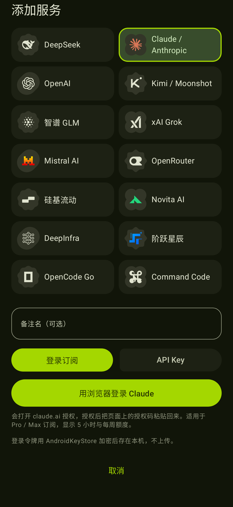

# aiuse

**AiUseage**：一个 Android 应用，把 16 家 AI 服务的余额、额度和订阅用量集中在一个界面里看。

**v1.9.5**（versionCode 22）· Kotlin + Jetpack Compose · Material 3 Expressive · minSdk 26 / targetSdk 35

<p align="center">
  
  
  
</p>

## 功能

- **16 家服务一屏看完**：API 余额、订阅窗口额度、多项额度（例如 Mistral 的 API 和 Vibe）都能显示。
- **订阅登录**：Claude Pro / Max 和 ChatGPT 订阅走 OAuth 登录，不需要 API Key。
- **统一换算**：实时汇率，USD / CNY 一键切换，顶部汇总所有服务。
- **额度分级**：低于 80% 是主色，80% 到 95% 是琥珀色，95% 以上是警示红。
- **排序**：长按拖动手动排序，也能按余额、名称或服务商排序。
- **后台刷新**：WorkManager 每 6 小时刷新一次，也可以下拉刷新。
- **左滑删除**：4 秒内可以撤销。

## 设计

整体基调是「有温度的仪表盘」：数字是主角，颜色只用在需要注意的地方。

- **Material 3 Expressive**：`MaterialExpressiveTheme`，动效用 `MotionScheme.expressive()`。位移带轻微回弹，颜色和透明度变化不回弹。
- **动态取色**：Android 12+ 默认跟随壁纸取色，设置里可以关掉。关掉后用种子色 `#4A6300` 生成的 Vibrant 色板。
- **分组列表**：首尾项是 24dp 大圆角，中间项 6dp。按下时圆角会收紧，拖起的卡片变成全圆角并抬高。
- **厂商标识**：logo 放在 MaterialShapes 异形容器里，颜色按深浅色分别处理，保证都看得清。
- **数字**：金额用 Roboto Flex 等宽数字，刷新后逐位滚动。系统开启减弱动效时，会关掉形状变形和数字滚动。

## 支持的服务

| 服务 | 接口 | 认证 |
|---|---|---|
| DeepSeek | `api.deepseek.com/user/balance` | Bearer |
| Anthropic | `api.anthropic.com` | API Key |
| OpenAI | `api.openai.com/v1/me` | Bearer |
| Kimi / Moonshot | `api.moonshot.cn/v1/users/me/balance` | Bearer |
| 智谱 GLM | `open.bigmodel.cn/api/paas/v4/usage` | Bearer |
| Mistral AI | `api.mistral.ai/v1/billing/budget` | `x-api-key` |
| xAI Grok | `cli-chat-proxy.grok.com/v1/billing` | OAuth 设备码 |
| OpenRouter | `openrouter.ai/api/v1/key` | Bearer |
| 硅基流动 | `api.siliconflow.cn/v1/user/info` | Bearer |
| Novita AI | `api.novita.ai/openapi/v1/billing/balance/detail` | Bearer |
| DeepInfra | `api.deepinfra.com/payment/checklist` | Bearer |
| 阶跃星辰 | `api.stepfun.com/v1/accounts` | Bearer |
| Claude 订阅 | `api.anthropic.com/api/oauth/usage` | OAuth PKCE |
| ChatGPT 订阅 | `chatgpt.com/backend-api/wham/usage` | OAuth 设备码 |
| OpenCode Go | `opencode.ai/zen/go/v1/usage` | Bearer |
| Command Code | `api.commandcode.ai/alpha/billing/credits` | Bearer |

要添加 Claude 或 ChatGPT 订阅，在「添加服务」里选 Anthropic 或 OpenAI，然后切到「登录订阅」。

## 安全

- **凭据加密**：AES-256-GCM，密钥存在 AndroidKeyStore，每次加密都用随机 IV。
- **元数据与凭据分开存**：`accounts.json` 里只有 id、服务商、名字和时间，不含任何 token。
- **凭据不离开设备**：所有请求直接发给服务商。项目没有后端，也没有崩溃上报或统计 SDK。
- **禁止明文传输**：`usesCleartextTraffic=false`，并配置了 `network_security_config`。
- **日志脱敏**：access token、refresh token、设备码和 PKCE verifier 都不会出现在日志、`toString()` 或错误信息里。
- **不进系统备份**：`allowBackup="false"`，并且 `dataExtractionRules` 排除了存储目录。

## 构建

需要：

- JDK 17
- Android SDK，compileSdk 37.1
- 项目自带 Gradle 9.3.1 wrapper 和 AGP 9.1.1，如果你本地或 CI 的版本较旧，需要先升级

```bash
git clone https://github.com/LYISTR2/aiuse.git
cd aiuse
echo "sdk.dir=$ANDROID_HOME" > local.properties
./gradlew :app:assembleDebug
# 产物：app/build/outputs/apk/debug/app-debug.apk
```

运行测试（188 个单元测试，包括 Robolectric 截图测试）：

```bash
./gradlew :app:testDebugUnitTest
```

> Material 3 Expressive 组件目前还没进稳定版，项目用的是 `compose-bom-alpha:2026.11.00`（material3 1.5.0-rc01）。稳定版发布后会换回去。

## 项目结构

```
app/src/main/java/ltd/usage/tracker/
├── crypto/        AES-256-GCM，密钥在 AndroidKeyStore
├── data/          模型、分离存储、刷新编排
├── provider/      OAuth 流程（Claude / Codex / xAI）
│   └── vendors/   各家用量接口，一家一个文件
├── work/          WorkManager 后台刷新
└── ui/
    ├── home/      顶栏、汇总卡、列表、拖动排序
    ├── account/   账号卡、额度条
    ├── add/       添加服务面板
    ├── login/     OAuth 登录弹窗
    └── theme/     配色、字体、形状、动效令牌
```

## 说明

- **各家用量接口大多没有公开**，是根据官方客户端的行为推断的。服务商一改接口，这里也得跟着改。
- **订阅登录借用了官方 CLI 公开的 OAuth client_id**，有条款和接口变更的风险。
- **这个项目不做**：账号体系、支付、自动更新、记账。

## 致谢

- 厂商 logo 来自 [lobe-icons](https://github.com/lobehub/lobe-icons)（MIT）。
- 字体使用 [Roboto Flex](https://github.com/googlefonts/roboto-flex)（OFL 1.1）。

## 许可

MIT
