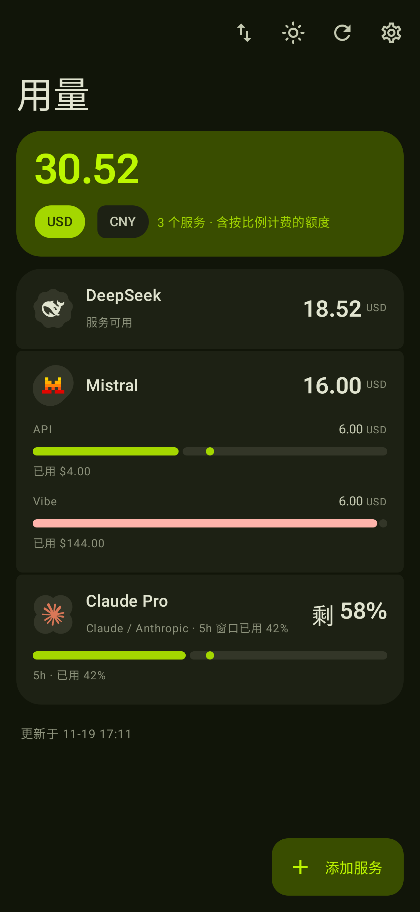
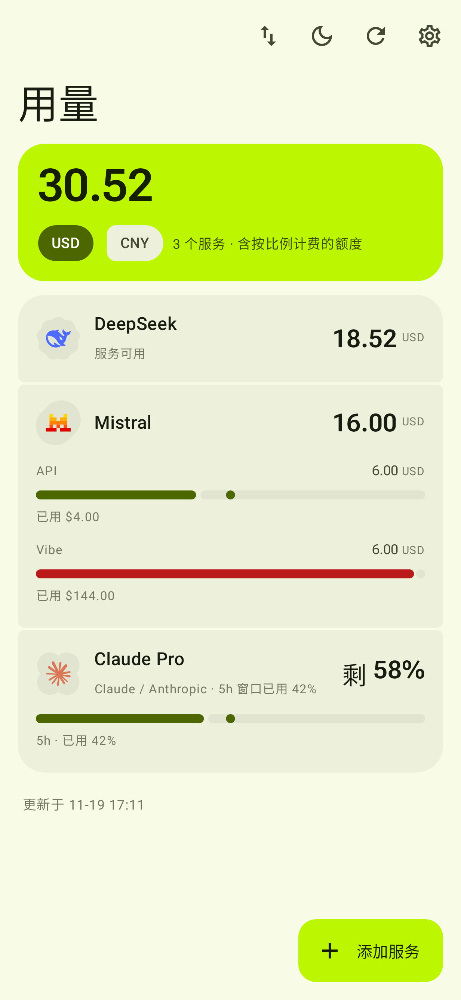

# aiuse

一个 Android 应用，在一个界面里查看各家 AI 服务的余额、额度和订阅用量，不用挨个打开官网后台。

  
  
  

- 支持 16 家服务：DeepSeek、Anthropic、OpenAI、Kimi、智谱 GLM、Mistral、xAI Grok、OpenRouter、硅基流动、Novita、DeepInfra、阶跃星辰、Claude 订阅、ChatGPT 订阅、OpenCode Go、Command Code
- Claude 和 ChatGPT 订阅可以直接登录，不需要 API Key
- 所有余额统一换算成 USD 或 CNY，额度快用完时变色提醒
- 凭据只加密保存在本机，请求直接发到服务商，没有后端

## 许可

MIT。厂商 logo 来自 [lobe-icons](https://github.com/lobehub/lobe-icons)（MIT），字体用的是 [Roboto Flex](https://github.com/googlefonts/roboto-flex)（OFL 1.1）。
