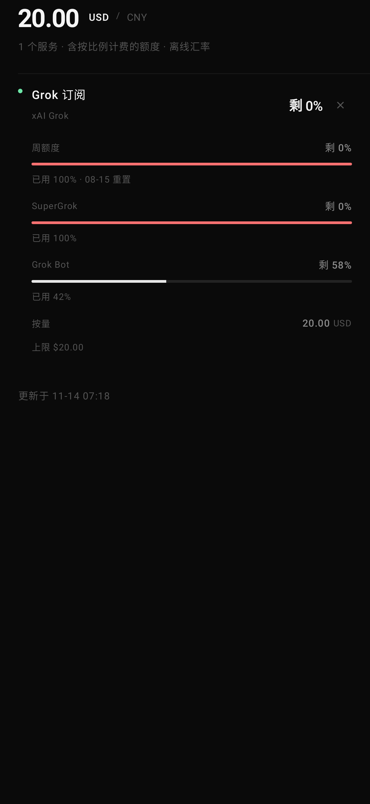
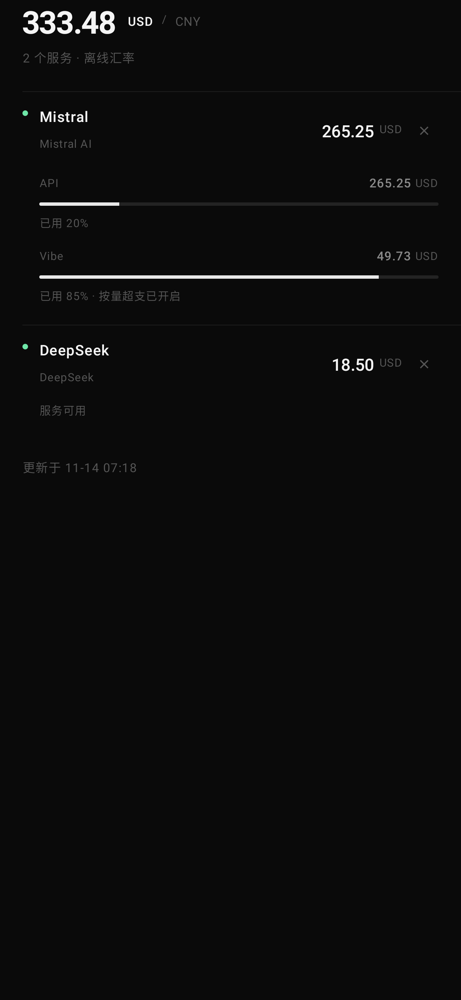

# AiUseage

AI 订阅用量追踪的 Android 应用。把各家 AI 服务的余额、额度、订阅用量集中在一个界面里看。

**v1.9.5**（versionCode 22）· Kotlin + Jetpack Compose · minSdk 26 / targetSdk 35

<p align="center">
  
  
  
</p>

## 功能

- **16 家服务**：DeepSeek、Anthropic、OpenAI、Kimi、智谱 GLM、Mistral、xAI Grok、OpenRouter、硅基流动、Novita、DeepInfra、阶跃星辰、Claude 订阅、ChatGPT 订阅、OpenCode Go、Command Code
- **多币种统一换算**：实时汇率，USD / CNY 一键切换
- **额度进度条**：已用 / 未用，超过 90% 转警示色
- **列表排序**：手动拖动 / 按余额 / 按名称 / 按服务商
- **深色 / 浅色主题**：极简单色设计，只有黑白灰
- **后台刷新**：WorkManager，6 小时周期
- **WebDAV 备份**：上传的是已加密的凭据原样字节

## 支持的服务

| 服务 | 接口 | 认证 |
|---|---|---|
| DeepSeek | `api.deepseek.com/user/balance` | Bearer |
| Anthropic / Claude | `api.anthropic.com/api/oauth/usage` | Bearer |
| OpenAI | `api.openai.com/v1/me` | Bearer |
| Kimi / Moonshot | `api.moonshot.cn/v1/users/me/balance` | Bearer |
| 智谱 GLM | `open.bigmodel.cn/api/paas/v4/usage` | Bearer |
| Mistral AI | `api.mistral.ai/v1/billing/budget` | `x-api-key` |
| xAI Grok | `cli-chat-proxy.grok.com/v1/billing` | OAuth 设备码 |
| OpenRouter | `openrouter.ai/api/v1/key` | Bearer |
| 硅基流动 | `api.siliconflow.cn/v1/user/info` | Bearer |
| Novita AI | `api.novita.ai/openapi/v1/billing/balance/detail` | Bearer |
| DeepInfra | `api.deepinfra.com/payment/checklist` | Bearer |
| 阶跃星辰 | `api.stepfun.com/v1/accounts` | Bearer |
| Claude 订阅 | `api.anthropic.com/api/oauth/usage` | OAuth PKCE |
| ChatGPT 订阅 | `chatgpt.com/backend-api/wham/usage` | OAuth 设备码 |
| OpenCode Go | `opencode.ai/zen/go/v1/usage` | Bearer |
| Command Code | `api.commandcode.ai/alpha/billing/credits` | Bearer |

Claude / ChatGPT 订阅在「添加服务」里选 Anthropic / OpenAI 后切到「登录订阅」。

## 安全

- **凭据加密**：AES-256-GCM，密钥在 AndroidKeyStore，应用进程拿不到密钥字节
- **元数据与密钥分离**：`accounts.json` 只有 id / provider / name / 时间，**没有任何 token 字段**
- **凭据不出设备**：所有请求直连服务商，本项目没有后端，未集成崩溃上报 / 分析 SDK
- **`toString()` 脱敏**：token 只输出 `***(长度)`
- **错误消息脱敏**：服务商回显 key 时按长度逐级替换为 `***`
- **备份安全**：WebDAV 强制 `https://`、文件名白名单、流式大小上限、CRLF 注入检查
- **系统备份隔离**：`allowBackup="false"` + `dataExtractionRules` 排除 `store/`

## 构建

需要 JDK 17 和 Android SDK（compileSdk 35、build-tools 35.0.0）。用项目自带的 Gradle wrapper，不用手动装 Gradle。

```bash
git clone https://github.com/LYISTR2/aiusegae.git
cd aiusegae

# 指定 Android SDK 路径（此文件已被 .gitignore 排除）
echo "sdk.dir=$ANDROID_HOME" > local.properties

./gradlew :app:assembleDebug
# 产物：app/build/outputs/apk/debug/app-debug.apk
```

运行测试：

```bash
./gradlew :app:testDebugUnitTest
```

143 个单元测试，覆盖余额解析、凭据安全、汇率换算、WebDAV 传输安全、OAuth 流程、拖动排序。

## 项目结构

```
app/src/main/java/ltd/usage/tracker/
├── crypto/CredentialCipher.kt     AES-256-GCM，密钥在 AndroidKeyStore
├── data/
│   ├── Models.kt                  Provider / Credential / UsageSnapshot / Metric
│   ├── Store.kt                   元数据与加密凭据分离存储
│   └── UsageSync.kt               前台/后台共用的刷新编排
├── provider/
│   ├── UsageFetcher.kt            各家服务的用量接口
│   └── XaiOAuth.kt                xAI 设备码 OAuth 流程
├── backup/WebDavClient.kt         WebDAV 备份
├── work/                          WorkManager 后台刷新
└── ui/
    ├── MainActivity.kt            入口
    ├── home/                      列表、排序、拖动
    ├── account/ add/ login/       账号与登录流程
    └── theme/Design.kt            配色 / 排版 / 动效令牌
```

## 说明

- **各家用量接口非公开**，是从客户端行为推断的，对方改接口就得跟着改。这是这类应用的根本脆弱点。
- **OAuth 订阅登录借用官方 CLI 的 client_id**，接口未公开，存在条款与变更风险。
- **不做**：账号体系、支付、自更新、记账。

## 许可

MIT
